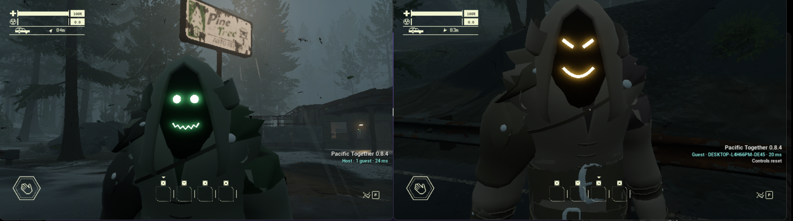

# Pacific Together

**Play Pacific Drive with a friend.** One drives, one rides shotgun, both scavenge — the same car, the same run, the same
Olympic Exclusion Zone.

[-2b6cb0)](https://store.steampowered.com/app/1458140/Pacific_Drive/)

> **Early access.** The mod is fully playable, but it is still being polished — expect the odd glitch, and see
> [Known issues](#known-issues). If something breaks mid-run, press **F9** for the rescue menu.

## Features

- 🚗 **One car, two players.** The host drives, the guest rides in the passenger seat and can start the engine or shift
  gears from there. Fuel, battery, damage, parts and storage are shared — both of you can repair, refuel and swap parts.
- 🎒 **Scavenge together.** Containers, pickups, abandoned cars and the garage storage are shared, and items keep their
  condition when you pass them around.
- 🌩️ **The same Zone for both.** Storms, instability, gateways and most anomalies happen for both players.
- 🧭 **One run, start to finish.** Travel through junctions and back to the garage together. Missions, radio calls,
  research, upgrades and the journal are shared; the guest can use garage stations too.
- 🧍 **See each other.** Each player has a hooded body with a glowing face (a different one for host and guest), holds
  their tools, and has a name tag with health. **Middle mouse** drops a ping your friend can see.
- ❤️ **Your own health and backpack.** The guest takes their own damage and radiation. If they die, their items wait in
  a crate and they respawn at the car. The host keeps the guest's backpack for next time.
- 🔗 **Easy joining.** Invite a friend through Steam, or join by IP address. No port forwarding needed over Steam.
- 💾 **Safe saves.** The host owns the world and save. The guest's own saves are protected while they play in someone
  else's game, and the installer backs up your saves before it changes anything.

## Install

**You need:** Pacific Drive on Steam, updated to the latest version (v1.15.0), on Windows. **Both players** install the mod,
and both need the **same mod version**.

1. **Download** the latest zip from [Releases](https://github.com/ikeepcalm/pacific-together/releases) and unpack it
   anywhere (for example, your Desktop).
2. **Close the game.** Open **`PacificTogether.exe`**. It finds your game folder; check that it is right.
3. Choose **Host** and click **Install & play**. *(Both players pick Host when joining through Steam — "Host" just
   means "no IP address needed".)*

Windows may warn that the launcher is from an unknown publisher: click **More info → Run anyway**.

## Play with a friend

**Through Steam (easiest)**

1. The host starts the game and **loads a save**.
2. The guest starts the game too, then either accepts the host's **Steam invite**, or right-clicks the host in the
   Steam friends list and picks **Join game**.

**By IP address**

1. In the launcher, the host picks **Host**; the guest picks **Join** and types the host's IP address.
2. The host loads a save; the guest connects from the main menu.
3. The host may need to forward **UDP port 7777** on their router (or you can both use a LAN or a VPN such as Radmin or
   ZeroTier).

## Controls

| Key | What it does |
|---|---|
| **E** on the passenger door | Get in the car (guest) |
| **X** | Get out of the car (guest) |
| **E** on the key or the shifter | Start/stop the engine or switch P/D from the passenger seat |
| **Middle mouse** | Ping a spot for your friend (**G** if the mouse button does not work) |
| **F9** | Rescue menu: teleport to your friend, resync, unstick controls, or complete a stuck story task |
| **End** or **F8** | Unstick the guest's controls |
| **Esc** (host) | Pauses the game for both players |

## Known issues

- Only the host can drive and plan the route. Detailing and buying quirk hints are host-only, and the Chrono Dilator is
  turned off in co-op.
- An anchor picked up by the guest can sometimes be deposited twice.
- A few anomalies are not visible to the guest yet, and weather or time of day can differ between the two players.
- Tutorial steps done by the guest alone do not count for the host.
- Playing with different DLC between host and guest has not been tested.

Found something else? Please [open an issue](https://github.com/ikeepcalm/pacific-together/issues). Click **Collect logs**
in the launcher on **both** PCs and attach the zips, plus what you were doing when it happened. Do this before restarting
the game, because the log is overwritten.

## Uninstall

Open `PacificTogether.exe` and click **Uninstall**. Your saves are not touched. Uninstalling also removes other UE4SS
mods, because it deletes the whole `ue4ss` folder. Every install backs up your saves to
`Documents\PacificDrive-saves-backup-<date>.zip` first.

## Support the mod

Pacific Together is free and always will be. If you enjoy it and want to see it grow, you can support development on
**[Patreon](https://www.patreon.com/cw/ikeepcalm)** ❤️

## Credits

- Built on [UE4SS](https://github.com/UE4SS-RE/RE-UE4SS).
- Pacific Drive is made by Ironwood Studios. This is a fan project and is not
  affiliated with or endorsed by them. The mod contains no game files.

## For developers

Source code is MIT licensed. 
Version history: [CHANGELOG.md](CHANGELOG.md). 
Setup, building and the test workflow: [docs/DEVELOPING.md](docs/DEVELOPING.md) and [docs/TESTING.md](docs/TESTING.md). 
Planned scope and open work: [docs/PLAN.md](docs/PLAN.md) and [docs/TASKS.md](docs/TASKS.md). Release steps: [docs/RELEASING.md](docs/RELEASING.md).
